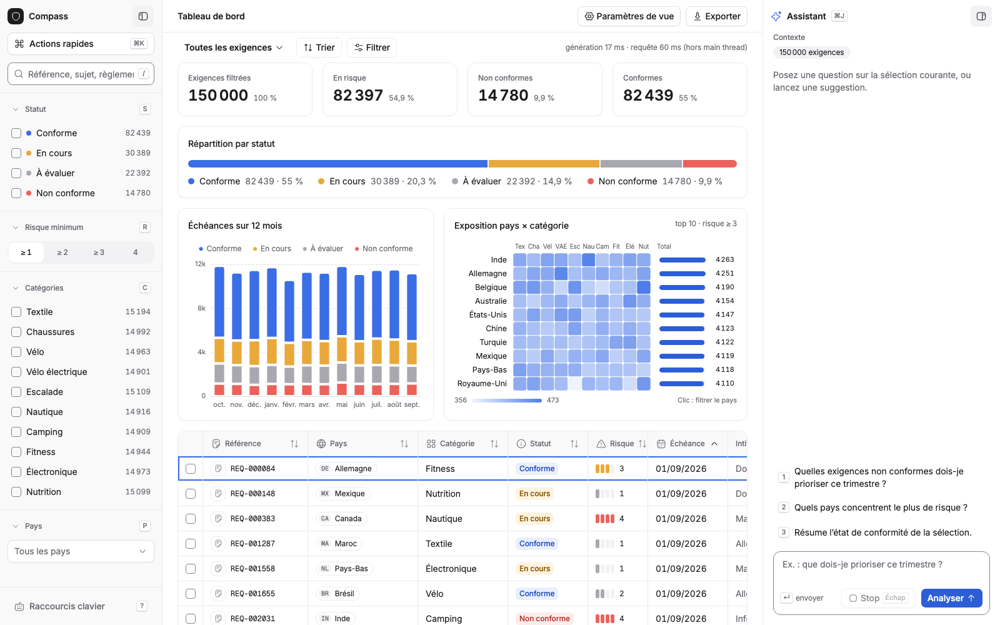
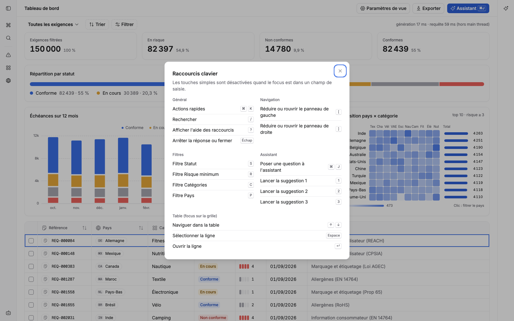
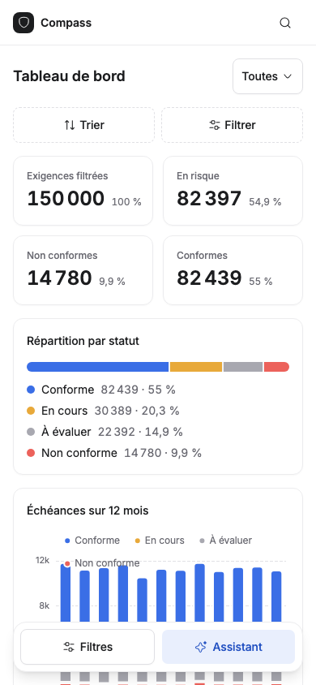

# Cadran Demo

Dashboard de pilotage de la conformité réglementaire, construit comme démo technique pour une mission Senior Frontend React. Le domaine est inspiré du projet Compass de Decathlon (exigences réglementaires par pays et par catégorie de produit), avec des données entièrement fictives et générées.

| Panneaux ouverts (1600×1000) | Panneaux réduits + aide `?` | Mobile (390×844) |
| --- | --- | --- |
|  |  |  |

## Lancer le projet

```bash
npm install
npm run dev          # http://localhost:5173 (sert aussi le faux endpoint IA en streaming)
npm test             # tests unitaires et composants (Vitest + Testing Library)
npm run e2e          # tests end-to-end (Playwright), après `npx playwright install chromium`
npm run build        # typecheck + build de production
```

## Stack

React 19, TypeScript strict, Vite, Zustand, TanStack Query, TanStack Virtual, Apache ECharts, Tailwind CSS v4, shadcn/ui (Radix UI, cmdk, vaul), Hugeicons, Inter et Geist Mono via @fontsource-variable, Vitest, React Testing Library, Playwright, GitHub Actions.

## Ce que la démo montre, point par point face à la fiche de mission

### Manipulation de larges jeux de données côté client

- **150 000 exigences** générées et interrogées dans un **Web Worker** (`src/workers/data.worker.ts`). Le filtre, le tri et toutes les agrégations se font en une seule passe, hors du main thread, donc l'interface ne gèle jamais.
- Le dataset n'est cloné vers le main thread qu'une fois. Ensuite chaque requête ne renvoie qu'un `Uint32Array` d'index, **transféré sans copie** (Transferable).
- La table est **virtualisée** avec TanStack Virtual : quel que soit le nombre de lignes, une trentaine seulement existent dans le DOM. Un test le vérifie explicitement.
- La saisie reste fluide grâce à `useDeferredValue`, et `keepPreviousData` de React Query évite le flash vide pendant les recalculs.
- Les composants lourds sont mémoïsés (`memo`, `useMemo`) et les sélecteurs Zustand sont ciblés pour éviter les re-rendus inutiles.

### Dataviz

- Quatre graphiques ECharts (donut, barres, carte de chaleur, courbe) en **rendu canvas** : aucun nœud DOM par point.
- **Import modulaire** d'ECharts et **chargement différé** du bloc graphique (`React.lazy`) : le bundle initial reste à environ 440 ko (141 ko gzip), ECharts (608 ko) étant chargé à part.
- **Filtrage croisé** : un clic sur un pays dans le graphique en barres filtre toute l'application.

### Intégration IA en streaming

- `src/hooks/useAssistantStream.ts` consomme une réponse **SSE via `fetch` et `ReadableStream`** (pas `EventSource`, qui ne gère ni le POST ni l'annulation).
- **Machine à états explicite** : `idle → thinking → streaming → done | aborted | error`, avec un squelette de chargement pendant la latence du premier token et un curseur pendant le flux.
- **Annulation** par `AbortController` (bouton Stop, nouvelle question, démontage du composant).
- **Rendu regroupé par frame** : les tokens s'accumulent dans une ref et l'état n'est mis à jour qu'une fois par `requestAnimationFrame`, au lieu d'un re-rendu par token.
- Le parseur SSE (`src/lib/sse.ts`) gère les événements coupés entre deux chunks réseau, ce qui est testé.
- On n'envoie au modèle que les agrégats, pas les 150 000 lignes.
- Le faux backend (`server/mockLlm.ts`) simule latence et tokens. Pour brancher une vraie API, seul l'endpoint change.

### Accessibilité

- Table avec la sémantique **ARIA grid** (`aria-rowcount`, `aria-rowindex`, `aria-sort`, `aria-activedescendant`) et une **navigation clavier complète** : flèches, Page Up/Down, Home/End, Entrée.
- Filtres en `fieldset`/`legend`, boutons bascule avec `aria-pressed`, labels associés à chaque champ.
- Graphiques décrits par `role="img"` et `aria-label`, avec le module ARIA d'ECharts activé.
- L'assistant annonce ses changements d'état dans une région `role="status"` sans relire chaque token aux lecteurs d'écran.
- `prefers-reduced-motion` respecté.

### Qualité

- TypeScript strict avec `noUncheckedIndexedAccess`.
- La logique métier (`src/data/query.ts`) est faite de **fonctions pures**, exécutées dans le worker en production et testées directement.
- Tests unitaires, tests de composants et 14 scénarios e2e Playwright (dont raccourcis, panneaux, mobile et audit axe WCAG AA), le tout dans une **CI GitHub Actions** (typecheck, tests, build, e2e avec rapport en cas d'échec).

## Design system : « CRM épuré » (shadcn/ui)

- **Tokens** : tout vit dans `src/index.css` (`:root` puis `@theme inline`), sans `tailwind.config.js`. Mode clair uniquement pour l'instant : le bloc `.dark` est conservé mais n'est plus appliqué (plus de bouton de thème ni de script de thème). Les statuts ont chacun trois tokens (`--status-*`, `-bg`, `-fg`) : une étiquette a toujours un fond, un texte et un libellé, la couleur ne porte jamais seule l'information. Rayons : 12 px cartes, 8 px boutons et champs, 6 px étiquettes, 999 px pastilles.
- **Contrastes** : `--input` (#e0e0e4) ne fait que 1,3:1 sur blanc. Il sert aux pointillés et aux boutons ; les vrais champs de saisie et les cases à cocher utilisent `--input-strong` (≥ 3:1, WCAG 1.4.11). Un test axe (`wcag2aa`) tourne en desktop et en mobile.
- **Icônes** : Hugeicons via le wrapper `components/ui/icon.tsx` (trait 1,6, `aria-hidden` par défaut).
- **Mise en page** : filtres (260 px) / centre fluide. L'assistant est une fenêtre flottante en bas à droite (400 px, bouton rond une fois fermée) qui se superpose au tableau de bord sans le redimensionner ; les filtres se réduisent en rail de 52 px (`(`, bouton avec `aria-expanded` et `aria-controls`). L'état est mémorisé dans `localStorage` (`try/catch`, repli sur « filtres ouverts, assistant fermé »). Sous 768 px les panneaux deviennent des tiroirs vaul ouverts depuis une barre flottante, la table devient une liste virtualisée, et aucun raccourci n'est affiché.
- **Raccourcis** : un registre unique (`src/lib/shortcuts.ts`) alimente le hook global `useHotkeys` et la boîte d'aide `?`. Les touches simples sont ignorées dans un champ, sauf Échap et les combinaisons ⌘/Ctrl.
- **ECharts** dessine dans un canvas et ne lit ni `var(--x)` ni `color-mix()`. `useChartTheme` lit les tokens avec `getComputedStyle`, les convertit en `rgb()` via un canvas 1x1 et se met à jour si la classe de `<html>` change. La carte de chaleur (cellules de 20 px, sans texte) expose un résumé textuel de ses cellules les plus exposées ; ses barres de total par pays sont des boutons `aria-pressed` qui filtrent sur le pays. La répartition par statut est une barre HTML pleine largeur.
- **Pourquoi pas le composant `Table` de shadcn ?** Il rend un vrai `<table>`. La virtualisation positionne les lignes en absolu avec `translateY`, ce qui est incompatible avec ce modèle. La table garde sa structure ARIA grid (`div role="grid"`, `row`, `gridcell`, `columnheader`) et son clavier (flèches, Page, Home/End, Espace, Entrée).
- **Données** : deux agrégats ont été ajoutés au worker, sans changer le reste du calcul : `deadlinesByStatus` (barres empilées) et `byCategory` (volumes des filtres).
- **Captures** : `docs/` (ouvert 1600×1000, réduit + aide, mobile 390×844).

## Anecdote utile en entretien

Le test e2e « l'assistant peut être interrompu » a révélé un vrai bug. Les boutons « Analyser » (`type="submit"`) et « Stop » (`type="button"`) étaient rendus au même emplacement d'un ternaire, donc React réutilisait le même nœud DOM. Le clic sur Stop finissait par soumettre le formulaire, ce qui relançait une requête au lieu d'annuler la précédente. La correction tient en deux lignes : une `key` distincte sur chaque bouton pour forcer deux nœuds séparés, et une garde dans `onSubmit` quand une génération est déjà en cours. Le panneau actuel affiche Stop et Analyser en permanence (Stop désactivé hors génération), ce qui supprime le piège à la source ; la garde reste.

## Pistes d'évolution à évoquer

- Remplacer SSE par **WebSocket** pour un dialogue bidirectionnel (la même machine à états s'applique).
- Passer le tri et le filtre sur `SharedArrayBuffer` ou une base en mémoire type DuckDB-WASM au-delà du million de lignes.
- Carte géographique réelle (ECharts geo ou MapLibre) à la place de la carte de chaleur.
- Storybook pour documenter les composants et tests d'accessibilité automatisés avec axe-core.
