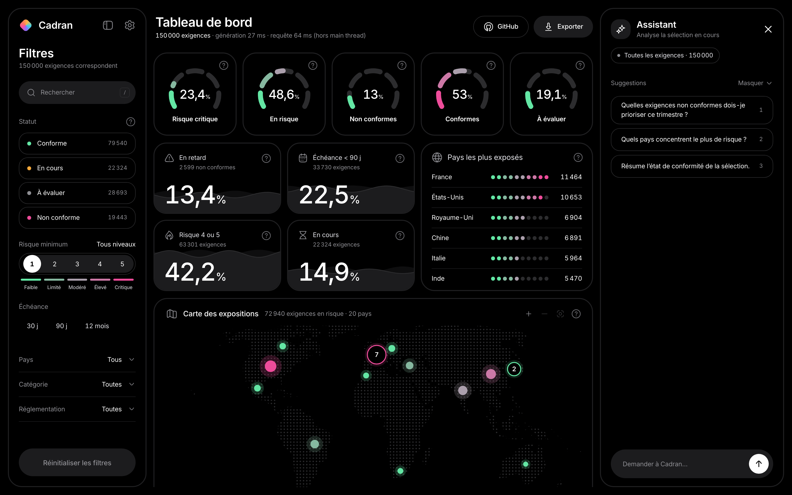
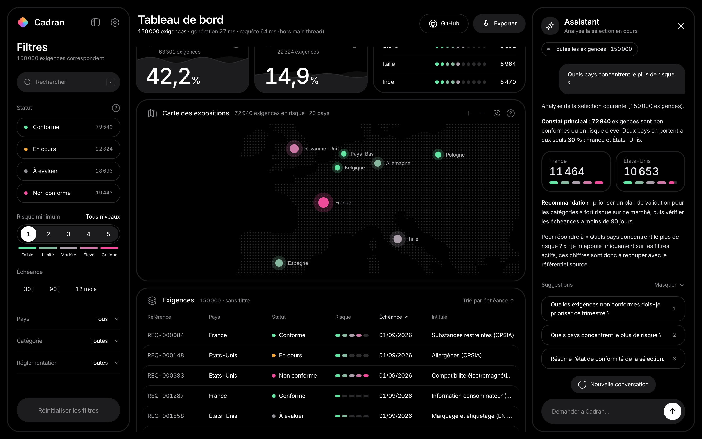
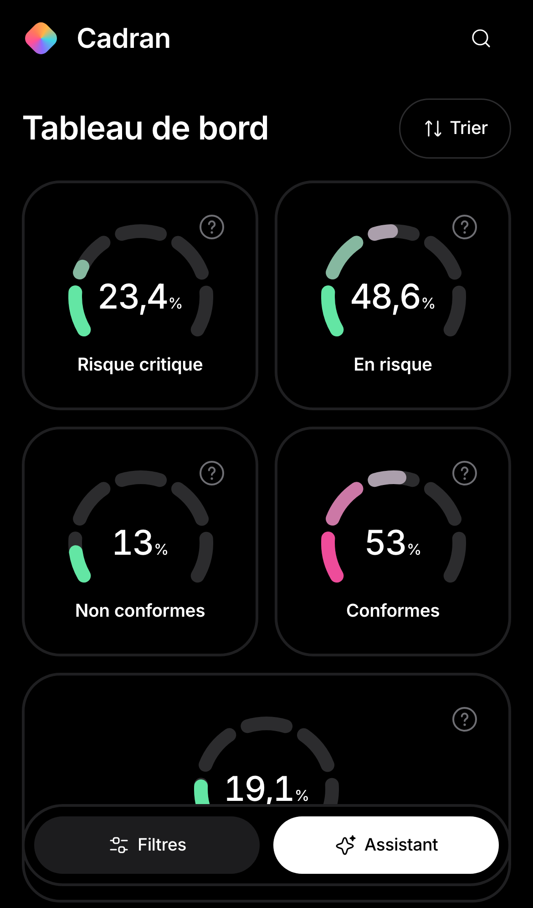
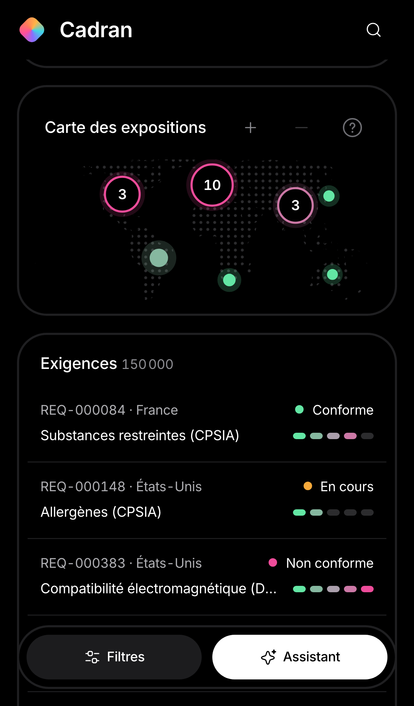
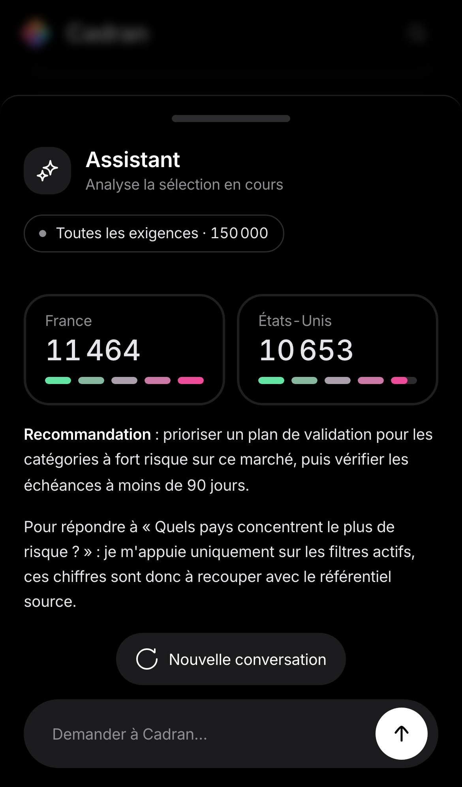

# Cadran

Tableau de bord de pilotage de la conformité réglementaire : **jusqu'à 1 000 000 d'exigences** par pays, catégorie, statut, risque et échéance, avec un assistant IA en streaming. Projet de démonstration (données fictives, générées de façon déterministe).

> **Montée en charge en un clic** : le sélecteur flottant `150 k | 1 M`, en bas à droite, régénère le référentiel à 1 million d'exigences. Filtres, tri, recherche, carte et table restent fluides : aucune tâche longue sur le main thread.

Ce qu'il met en avant :

- **Performance** : 1 million d'exigences filtrées, triées et agrégées côté client sans bloquer l'interface (Web Worker, données en colonnes transférées sans copie, tri en O(n), virtualisation sans plafond de volume).
- **Visualisation de données** sur mesure en SVG, dont une carte du monde interactive avec regroupement et zoom.
- **Intégration IA** en streaming (SSE, machine à états, annulation).
- **Accessibilité** visée WCAG 2.2 AA (ARIA grid, navigation clavier, audit axe automatisé) et **tests** unitaires, de composants et end-to-end.

| Bureau (1600×1000) | Carte zoomée et réponse de l'assistant |
| --- | --- |
|  |  |

| Mobile (390×844) | Carte | Assistant |
| --- | --- | --- |
|  |  |  |

## Lancer le projet

```bash
npm install
npm run dev          # http://localhost:5173 (sert aussi le faux endpoint IA en streaming)
npm test             # tests unitaires et composants (Vitest + Testing Library)
npm run e2e          # tests end-to-end (Playwright), après `npx playwright install chromium`
npm run build        # typecheck + build de production
```

## Stack

React 19, TypeScript strict, Vite, Zustand, TanStack Query, d3-geo, Tailwind CSS v4, shadcn/ui (Radix UI), Vitest, React Testing Library, Playwright, GitHub Actions.

## Architecture

```
┌────────────────────────── main thread ──────────────────────────┐
│  Composants React (présentation, ARIA, raccourcis)              │
│        ▲ sélecteurs ciblés                  ▲ résultats         │
│  Zustand : filtres, tri, UI      TanStack Query : cache, états  │
│        │                                    │                   │
│        └──────────► lib/dataWorker (RPC par Promise) ◄──────────┤
└──────────────────────────────┬──────────────────────────────────┘
                               │ postMessage : colonnes (typed arrays) puis index (Uint32Array), transférés sans copie
┌──────────────────────────────▼──────────────────────────────────┐
│  Web Worker : 150 k à 1 M exigences, filtre + tri + agrégats    │
│  src/data/query.ts : fonctions pures, testables sans navigateur │
└─────────────────────────────────────────────────────────────────┘

Assistant IA : hook useAssistantStream ──fetch + ReadableStream (SSE)──► /api/assistant
```

Les choix structurants :

- **Les calculs sortent du main thread.** Le worker est exposé comme un backend asynchrone via une petite couche RPC (`src/lib/dataWorker.ts`) : chaque appel renvoie une `Promise`, branchée directement dans React Query (cache, annulation, états de chargement). Remplacer le worker par une vraie API HTTP ne changerait que cette couche.
- **La logique métier est pure.** `src/data/query.ts` et `src/lib/geo.ts` n'importent ni React ni le DOM : ils tournent dans le worker ou le navigateur et se testent directement en Vitest.
- **Un état par nature.** Zustand pour l'état synchrone (filtres, panneaux), React Query pour l'asynchrone, avec des sélecteurs ciblés pour éviter les re-rendus en cascade.
- **Une source unique pour les raccourcis** (`src/lib/shortcuts.ts`) : le même registre alimente le gestionnaire clavier et la boîte d'aide `?`, qui ne peuvent donc pas diverger.

## Performance

### Jusqu'à 1 000 000 d'exigences

Le sélecteur flottant `150 k | 1 M` régénère le référentiel dans le worker ; l'ancien reste affiché pendant la génération. Mesures à 1 M dans Chromium (Playwright, poste de développement) :

| | 1 000 000 d'exigences |
| --- | --- |
| Génération (worker) | ~200 ms |
| Requête complète : filtre + tri + agrégats (worker) | ~30 à 100 ms |
| Passage 150 k → 1 M, du clic à l'affichage | < 1 s |
| Tâches longues (> 50 ms) sur le main thread : passage à 1 M, saisie d'une recherche, zoom et déplacement de la carte, tri, filtre, navigation jusqu'en fin de table | aucune |

Un test e2e vérifie à chaque palier, dans les deux sens, que la table contient exactement le nombre d'exigences annoncé et que la dernière ligne est bien `REQ-1000000`.

### Comment

- Filtre, tri et toutes les agrégations en **une seule passe** dans un **Web Worker**.
- Le main thread ne reçoit jamais d'objets : le worker lui **transfère** le référentiel **en colonnes** (typed arrays, ~13 octets par exigence), puis chaque requête ne renvoie qu'un `Uint32Array` d'index. Les lignes sont reconstruites à la demande (`RowSet`) : seule la trentaine affichée par la table existe en mémoire.
- Tri **par comptage** en O(n) (toutes les clés sont de faible cardinalité) : environ 20 ms à 1 M de lignes, contre environ 200 ms pour `sort` + `localeCompare` (mesuré sous Node).
- Table **virtualisée** : une trentaine de lignes dans le DOM quel que soit le volume, ce qu'un test vérifie. Au-delà de 15 M px (1 M de lignes = 46 M px, plus que la hauteur maximale d'un élément dans Chrome ou Firefox), la hauteur défilable est plafonnée et le défilement mis à l'échelle (`src/hooks/useFixedVirtual.ts`) : la dernière ligne reste atteignable.
- Saisie fluide grâce à `useDeferredValue` ; `keepPreviousData` évite le flash vide pendant les recalculs.
- Animations (jauges, vagues, zoom de la carte) pilotées par `requestAnimationFrame` ; les vagues se redessinent sans re-rendu React et s'arrêtent hors écran.
- **Diagnostic au profiler** : en dev, React 19 compare en profondeur les props modifiées pour sa piste « Components », ce qui coûtait environ 1 s par commit sur le tableau de 150 000 lignes. Le tableau de lignes a depuis laissé place à un accès paresseux (`RowSet`), qui supprime le problème à la source.

## Visualisation de données

Les visualisations sont des composants **SVG maison** plutôt qu'une bibliothèque de graphiques : le design demandait des formes spécifiques (jauges segmentées, remplissages en vague, carte en points) que les bibliothèques rendent mal, et le SVG lit directement les tokens CSS du thème.

- **Jauges segmentées** : un seul arc, découpé en 5 segments par `stroke-dasharray`/`dashoffset`.
- **Cartes en vague** : sinusoïde lissée (Catmull-Rom → Bézier) dont la hauteur suit la valeur.
- **Animation cohérente** : un hook `useTween` partagé (même durée, même courbe) qui repart de la valeur affichée si les données changent en cours d'animation.
- **Honnêteté des chiffres** : une part au dénominateur nul s'affiche « — » plutôt qu'un 0 % trompeur.
- **Filtrage croisé** : cliquer un pays dans le classement ou sur la carte filtre toute l'application.

### Carte du monde

- Projection Equal Earth (d3-geo) et tracé Natural Earth (~50 Ko), calculés une fois au chargement. Les continents sont une trame de points dont le pas reste constant à l'écran : zoomer ajoute des points au lieu de les grossir.
- **Regroupement des pays proches** à l'échelle courante (algorithme glouton sur barycentres pondérés). Cliquer un groupe zoome juste assez pour séparer ses membres.
- Zoom, déplacement à la souris ou au doigt, sans que le glisser ne déclenche de clic parasite.
- Regroupement et calcul du zoom sont des fonctions pures testées unitairement.

## Intégration IA en streaming

- Consommation **SSE via `fetch` et `ReadableStream`** plutôt qu'`EventSource`, qui ne gère ni le POST ni l'annulation.
- **Machine à états explicite** : `idle → thinking → streaming → done | aborted | error`.
- **Annulation** par `AbortController` (bouton Arrêter, Échap, nouvelle question, démontage).
- **Un rendu par frame** et non par token : les tokens s'accumulent dans une ref, l'état est mis à jour une fois par `requestAnimationFrame`.
- Parseur SSE robuste aux événements coupés entre deux chunks réseau, couvert par des tests.
- Seuls les **agrégats** sont envoyés au modèle, jamais les lignes brutes.
- Backend simulé (plugin Vite en local, Vercel Function en ligne) : brancher un vrai LLM ne change que l'endpoint.

## Accessibilité

- Table en **ARIA grid** (`aria-rowcount`, `aria-rowindex`, `aria-sort`, `aria-activedescendant`) avec navigation clavier par ligne (flèches, Page Up/Down, Début/Fin, Entrée).
- Lien d'évitement vers le contenu principal ; raccourcis à une touche désactivables dans Réglages et coupés d'office sur mobile (WCAG 2.1.4).
- Visualisations décrites textuellement ; points de la carte focusables et activables au clavier.
- L'assistant annonce ses changements d'état via `role="status"` sans faire relire chaque token.
- `prefers-reduced-motion` respecté ; la couleur ne porte jamais seule l'information ; contrastes visés, y compris pour les contrôles (WCAG 1.4.11).
- **Audit axe WCAG 2.0 à 2.2, niveaux A et AA** automatisé en e2e, en desktop et en mobile, y compris avec une réponse de l'assistant et la fiche d'exigence ouverte.
- Limites : un audit automatisé ne détecte qu'une partie des défauts. Aucun audit manuel ni test aux lecteurs d'écran n'a été mené ; le projet ne revendique donc pas de conformité RGAA.

## Design system

- Tokens dans `src/index.css` exposés à Tailwind v4 via `@theme inline` (couleurs, échelle typographique, rayons). Les composants n'utilisent pas de valeurs arbitraires.
- shadcn/ui sur Radix UI, avec ses tokens redirigés vers ceux du projet.
- Mise en page en 3 zones sur bureau (filtres, tableau de bord, assistant), panneaux réductibles et mémorisés ; sur mobile, tiroirs, liste virtualisée et cibles tactiles de 44 px.
- La table n'utilise pas le `Table` de shadcn : un vrai `<table>` est incompatible avec le positionnement absolu de la virtualisation. Elle garde une sémantique ARIA grid sur des `div`.

## Qualité et tests

- **TypeScript strict** avec `noUncheckedIndexedAccess`.
- **Pyramide de tests** : fonctions pures en unitaire (requêtes et agrégats, équivalence du tri par comptage avec le comparateur, génération, virtualisation à 1 M, géographie, parseur SSE, raccourcis), composants avec Testing Library, parcours complets avec Playwright (filtres, cohérence des totaux, nombre de lignes à 150 k et 1 M, carte, tri, raccourcis, annulation de l'assistant, mobile, accessibilité).
- **CI GitHub Actions** : typecheck, tests, build, puis e2e avec publication du rapport en cas d'échec.

### Retours d'expérience : des bugs révélés par l'e2e

**La fin du tableau inatteignable à 1 M.** En vérifiant qu'à chaque palier la table contient le bon nombre de lignes, la touche Fin s'arrêtait à la ligne 729 456 sur 1 000 000. Cause : 1 M de lignes de 46 px font 46 M px, au-delà de la hauteur maximale d'un élément (≈ 33,5 M px dans Chrome, ≈ 17,9 M px dans Firefox). Correctif : une virtualisation à hauteur fixe (`src/hooks/useFixedVirtual.ts`) qui plafonne la hauteur défilable à 15 M px et met la position de défilement à l'échelle. En dessous du plafond, le comportement est inchangé.

**Stop qui relançait la requête.**

Le test « l'assistant peut être interrompu » a mis au jour un défaut réel. Les boutons « Analyser » (`type="submit"`) et « Stop » (`type="button"`) occupaient le même emplacement d'un ternaire : React réutilisait le même nœud DOM, si bien qu'un clic sur Stop soumettait le formulaire et relançait une requête au lieu d'annuler. Correctif : une `key` distincte par bouton et une garde dans `onSubmit`. Depuis, « Arrêter » vit hors du formulaire, ce qui supprime le piège à la source ; la garde reste en défense.

## Pistes d'évolution

- Découpage du bundle (`import()` dynamique de la carte et de l'assistant).
- `SharedArrayBuffer` ou DuckDB-WASM au-delà du million de lignes.
- WebSocket à la place de SSE pour un dialogue bidirectionnel, avec la même machine à états.
- Storybook pour documenter les composants.
